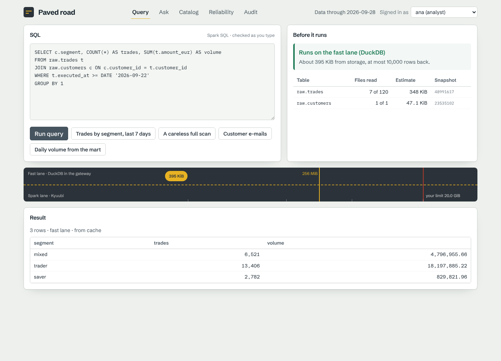

# analytics-paved-road

**A self-serve analytical plane for a neobroker, on Apache Iceberg.** Every query goes through a
gateway that checks it against the access policy, estimates what it will scan from Iceberg
metadata, and runs it on DuckDB in the gateway or on Spark through Kyuubi. Data producers write
one contract per data product and get the table, the dbt tests, the Airflow DAG, the dashboard
and the alerts from it. Reliability is run on SLOs with error budgets, failure drills and shadow
replays; questions in plain language are answered from defined metrics only.

The problem it answers is the one a data platform team at a fast-growing broker has every day:
*hundreds of people and automations want answers from the lake, some of the data is personal or
financial, a careless query can scan terabytes, and the platform must stay fast, cheap and
correct without a platform engineer reviewing each query.*



## What is in it

| Part | What it does |
|---|---|
| **Lake** (`apr.lake`, PyIceberg) | A simulated broker (20,000 customers, 18 markets, 1,500 instruments, 120 days: trades, savings plans, cash, prices) in Iceberg tables created from the contracts, partitioned by day or month. Local SQLite catalog for development; the Iceberg REST catalog on MinIO in kind; Glue's Iceberg REST endpoint on AWS. **Write-audit-publish**: each batch goes to an audit branch, is checked against its contract, and only then moves `main`. Compaction and snapshot expiry (`apr maintain`). |
| **Query gateway** (`apr.gateway`, FastAPI, sqlglot) | Spark SQL in; read-only and data products only; columns resolved against what the role may see; each table rewritten into a sub-query that applies the role's masks at a pinned snapshot; partition filters required on big tables; scan estimated from manifests (partition pruning, column statistics, projected column sizes); per-role scan limits; **fast lane** (DuckDB in the pod, up to 256 MiB) or **Spark lane** (Kyuubi, HiveServer2 protocol, `VERSION AS OF`); degraded fast-lane runs when Kyuubi is down; admission control per lane and per user; results cached by snapshot; Prometheus metrics; an audit line per request. |
| **Paved road** (`config/products/`, `apr new`, `apr lint`, `apr generate`) | One YAML contract per product: schema, classification per column, partitioning, owner, freshness objective, quality checks, upstream. Generated from it: dbt model contracts and tests, Airflow DAGs (marts scheduled on their upstream **assets**), Grafana panels, freshness alerts. `apr lint` in CI catches unclassified personal data, impossible freshness promises and, against the base branch, breaking changes. |
| **Transformations** (`transform/`, dbt) | dbt-duckdb reads the raw Iceberg tables through PyIceberg and builds the marts under enforced model contracts; `apr publish` writes them to Iceberg with write-audit-publish. A `spark` target runs the same models through Kyuubi. |
| **Semantic layer and questions** (`config/metrics.yaml`, `apr.semantic`, `apr.ask`) | 13 metrics, 5 dimensions. A question becomes a metric query (rules, or Claude with a tool schema and no data), is validated, compiled and run **through the gateway as the asking user**; the answer sentence is written by code from the result rows. |
| **Reliability** (`config/slo.yaml`, `apr.slo`, `apr.drills`, `apr.rollout`) | SLOs on availability (overall and per lane), latency per lane and product freshness; recording rules and multi-window multi-burn-rate alerts generated and unit-tested with promtool; an error budget policy that blocks releases. Drills inject failures and write postmortem timelines. Shadow replays test a policy or engine change against the audit log. |
| **Workload simulator** (`apr.workload`) | 300 people and n8n workflows for 30 days, through the gateway and against the baseline (every query on the Spark cluster). Access decisions, estimates and result rows come from the real planner and real execution; only queueing and execution time are modelled. |
| **Console** (`console/`, React 19, Vite, Tailwind v4, Motion) | Query with a live dry run and the lane strip, Ask, Catalog with each column's access for the signed-in role, Reliability (SLOs and drills), Audit. |
| **n8n node** (`integrations/n8n-nodes-paved-road`, TypeScript) | Run SQL, ask, and check freshness from n8n workflows through the gateway, with retries on 429 and 503. |
| **Platform** (`docker/`, `deploy/`, `.github/`) | One image; Kustomize for the gateway (HPA, PDB, network policy, non-root, read-only root), Kyuubi with the Iceberg runtime, MinIO, the REST catalog, Prometheus with the generated rules, Grafana with the generated dashboard; Terraform for AWS (S3 with KMS, Glue databases, IRSA roles for the gateway and the pipelines). CI runs everything below and a kind cluster where the Spark lane is checked against the fast lane. |

## Results

### A month of the workload (simulated, `reports/workload/SUMMARY.md`)

300 people and n8n workflows, 30 days, the same arrivals played through the gateway and against
the baseline: every query sent as written to the Spark cluster. Access decisions, byte
estimates and result rows come from the real planner and real execution on the lake (9,578
distinct queries); bytes are scaled ×500 to production volume, execution and queueing times
are modelled (`config/workload.yaml`). The month includes the drill day's faults.

| | Every query on Spark | Through the gateway |
|---|---|---|
| Data scanned (production scale) | 224.7 TB | **21.6 TB** |
| Scan cost at an assumed $5/TB | $1,124 | $108 + $420 for the gateway pods |
| Personal-data cells returned to roles not cleared for them | 4,231,200 | **0** |
| Median wait for people's answers | 2.94 s | **0.03 s** |
| 95th percentile, all people's queries / only those not cached | 6.49 s | 3.20 s / 5.68 s |
| People's queries answered | 99.6% | 96.2% (the rest refused by policy) |

- **Most of the saving is the partition rule and the marts, not the cache.** 19,807 queries
  were refused for a missing partition filter; 21,699 of the people's retries, written from the
  refusal message, were answered.
- **The cache flatters latency.** 89% of people's answers came from the snapshot-keyed cache
  (dashboards and repeated questions); a query that has to run is answered in 5.68 s at the
  95th percentile against 6.49 s, because large scans still go to Spark.
- Every result was checked for clear names, e-mails, IBANs and birth dates for every role but
  compliance: 0 found in 9,578 distinct queries.

### Error budgets over the month (`reports/slo/status.json`, `apr budget`)

| Objective | Target | Achieved | Budget left |
|---|---|---|---|
| Gateway availability | 99.5% | 99.985% | 97% |
| Spark-lane availability | 99.0% | 99.70% | 70% (the 40-minute outage) |
| Fast-lane queries within 2 s | 95% | 100.0% | 100% |
| Spark-lane queries within 2 min | 90% | 100.0% | 100% |

### Failure drills (`reports/drills/`, `apr drill`)

| Drill | Kind | What happened |
|---|---|---|
| Spark lane down 40 min | simulated | Queries up to 1 GiB ran degraded on DuckDB (44 failures instead of 60 among people; the baseline failed 463). The Spark-lane objective **paged 7 minutes in**. |
| Catalog 2.5 s slower for an hour | simulated | With the gateway's 30-second metadata cache 85% of fast-lane queries stayed under 2 s and nothing paged; without it, none did and the latency objective paged. |
| One n8n workflow sends 40 queries/s | simulated | Admission control held it to 2 at a time and refused 16,268 with 429; everyone else's 95th percentile went from 3.02 s to 3.14 s. Without admission control it would have been 41 minutes. |
| `raw.trades` lands 3 hours late | real | A ticket to the source team at 06:10, a page to the mart owner at 07:10; the mart published 42 minutes late; readers saw the previous day, never a partial one. |
| A corrupt trades batch | real | 50 negative amounts and 20 duplicate ids failed the contract on the audit branch; `main` did not move; 0 rows visible until the clean batch was published. |

**What the first drill run found.** The first version only opened *tickets* for the Spark
outage: cache hits and degraded runs kept the overall availability ratio under the paging
threshold while 10% of people's queries failed. The fix is a component objective for the
Spark lane that counts only queries the lane had to run; it now pages at 10:07. The first
storm drill compared against a gateway with infinite capacity; the engine is now shared when
admission control is off, and the drill compares against the same hour without the storm.
The first results are kept in `reports/drills/history/v1-drills.json`.

### Blind held-out sets (first and only runs, `reports/heldout/`)

Written by a separate agent from `docs/ACCESS.md`, `docs/METRICS.md`, the contracts and
`heldout/WRITING_*.md` only, run once on commit `2cc2d6d`, pinned by sha256 in
`tests/test_heldout.py`. Their failures have not been studied.

| Set | Result |
|---|---|
| 40 access cases (users, SQL, expected decision, rule and masked columns) | **40 of 40** decided as documented |
| 40 questions (30 answerable, 10 not) with the rule-based parser | **19 of 30** answered correctly, 2 refused, **9 answered wrongly**; 6 of 10 refused correctly, **4 answered** |

The access rules hold as written. The rule-based question parser does not: 13 of 40 questions
got a wrong answer, which is worse than a refusal. The answer screen shows the metric query
that ran, and the parser should not answer unattended (for example in n8n) until a better
parser beats it on a new blind set.

## Run it

```bash
python3.12 -m venv .venv && .venv/bin/pip install -e ".[dev,dbt]"
.venv/bin/apr build                     # 120 days into .lake, dbt marts, publish, compaction (~3 min)
(cd console && npm ci && npm run build)
.venv/bin/apr serve                     # http://127.0.0.1:8000 (switch users top right)
```

```bash
apr query "SELECT channel, COUNT(*) FROM raw.trades WHERE executed_at >= DATE '2026-09-22' GROUP BY 1" --user ana
apr ask "Top 5 countries by trading volume last month" --user pia -v
apr lint && apr generate                # contracts and everything generated from them
apr simulate && apr drill && apr budget # reports/workload, reports/slo, reports/drills
apr shadow config/roles.next.yaml       # what a policy change would change, from the audit log
APR_ASK=claude ANTHROPIC_API_KEY=... apr ask "..."   # Claude as the question parser
```

On Kubernetes: `docker build -f docker/Dockerfile -t analytics-paved-road:ci . && kubectl apply -k deploy`.

## Tests

| Suite | What it covers |
|---|---|
| Python (pytest, 120+) | contracts and lint, the simulated world (valid IBAN and ISIN check digits), write-audit-publish, the planner's rules (writes, table functions, denied and masked columns through sub-queries and CTEs, filter probing of masked columns, partition filters in their forms, pruning, row caps, names), snapshot-keyed cache, lanes and degradation, admission, audit, the semantic layer against hand-written SQL, the question parser's dev set and grounding, SLO rules and burn-rate detection times, the API, the simulator's shortcuts against the real engine, shadow replays, the real drills, the pinned held-out runs |
| Spark parity (CI, kind) | the same planned queries on the fast lane and on Spark via Kyuubi, compared |
| promtool | the generated alerts fire on a fast burn, stay quiet when healthy, and page for a late mart |
| Airflow | the DAG factory imports, one DAG per product, marts scheduled on their upstream assets, owners from the contracts |
| Console (Vitest) | loading, error with retry and empty states; decisions, refusals, lane strip, results; catalog access; ask; reliability |
| n8n node (Vitest) | rows to items, refusals and retryable errors, freshness, backoff |
| Terraform | fmt, validate |

## Limits

- **Simulated data.** The broker is generated; nothing is Trade Republic data. Rates are chosen
  to be plausible. Byte counts in the workload simulation are scaled ×500 to production volume
  and execution times are modelled; access decisions and results are real.
- **The Spark lane runs only in CI**, on kind with Spark in local mode inside the Kyuubi pod; it
  has not run on a real Spark-on-Kubernetes cluster. Locally the network blocks the images.
- **The AWS stack is validated as code** (`terraform validate`), not applied.
- **The rule-based question parser is not good enough to trust unattended** (see the held-out
  result). Answers show the metric query they ran; Claude as the parser has not been measured
  on the held-out set because no API key was available.
- Identity comes from a header set by the ingress; the OIDC proxy is not part of the repository.

## Documentation

`docs/ARCHITECTURE.md`, `docs/ACCESS.md` (for people writing queries), `docs/METRICS.md`
(generated), `docs/adr/` (access by rewriting, routing by estimate, write-audit-publish, models
parse and code computes), `docs/runbooks/`, `AGENTS.md` (invariants and the held-out rule),
`heldout/WRITING_*.md` (the guides the blind sets were written from).
